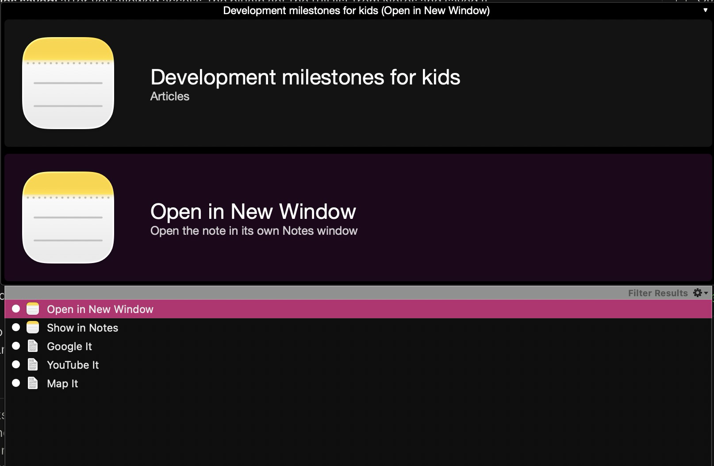

# Apple Notes plugin for Quicksilver

Find and open your Apple Notes by title from [Quicksilver](https://qsapp.com).



> **About this plugin:** the code was written entirely by
> [Claude Code](https://claude.com/claude-code). I have personally checked that
> the plugin works on my Mac, but I have not reviewed the code myself.
> Tested with Quicksilver 2.6.0 on macOS 26 (Apple Silicon).

## Features

- **Search notes by title.** Type part of a note's title in Quicksilver. Each
  result shows the note's title with its folder underneath. Only titles are
  indexed; note contents are never read.
- **Open in New Window** (the default action, Return) opens the note in its
  own Notes window.
- **Show in Notes** (the second action) selects the note, or a folder, in the
  main Notes window.
- **Browse folders.** Select the Notes app and press → to see your Notes
  folders; select a folder and press → again to see its notes, most recently
  edited first.
- **Recently edited notes rank a little higher** in searches, and notes you
  open often move up as Quicksilver learns your habits.
- **Catalog entries.** Quicksilver's Preferences → Catalog gets an
  "Apple Notes" group with "Notes" and "Folders".

## Install

1. Download `AppleNotes-qsplugin-<version>.zip` from the
   [latest release](https://github.com/terrazzano/AppleNotes-qsplugin/releases/latest)
   and unzip it.
2. The plugin isn't signed by a registered Apple developer, so macOS may refuse
   to load a downloaded copy. Clear the download flag in Terminal (in the folder
   where you unzipped it):

   ```bash
   xattr -dr com.apple.quarantine "Apple Notes.qsplugin"
   ```

3. Double-click `Apple Notes.qsplugin`; Quicksilver installs it. (Or copy it
   into `~/Library/Application Support/Quicksilver/PlugIns/` and restart
   Quicksilver.)
4. The first time the plugin reads your notes, macOS asks whether Quicksilver
   may control Notes. Click **Allow**. You can change this later in System
   Settings → Privacy & Security → Automation.

Requires Quicksilver 2.x and macOS 10.15 or later; the plugin runs on Apple
Silicon and Intel Macs.

### Good to know

- Titles are read from Notes only while Notes is running. When Notes is closed,
  Quicksilver uses the last list it saw, so the plugin never launches Notes in
  the background (except once, the very first time, if there is no list yet).
- A note you just created shows up in Quicksilver after the next catalog
  refresh while Notes is open. To pick it up right away, rescan the catalog in
  Quicksilver's Preferences → Catalog.
- The saved list of titles lives in
  `~/Library/Application Support/Quicksilver/Caches/AppleNotes.json`.

## Build from source

Needs only the Xcode Command Line Tools (`xcode-select --install`); the plugin
compiles against the headers inside `/Applications/Quicksilver.app`.

```bash
make install    # build, copy into Quicksilver's PlugIns folder, restart Quicksilver
make release    # build and zip the plugin into build/
```

| File | What it does |
| --- | --- |
| `Sources/QSAppleNotesSource.m` | Catalog source; icons, details and → children for Notes and folders |
| `Sources/QSAppleNotesActions.m` | Open in New Window / Show in Notes |
| `Sources/QSAppleNotesLibrary.m` | Runs the scripts, keeps the saved list of titles |
| `Sources/QSAppleNotesNote.m` | Note object and the ranker that favours recently edited notes |
| `Resources/*.js` | JavaScript for Automation scripts run with `osascript` |
| `Info.plist` | Plugin registration, actions and catalog presets |

## License

[Apache License 2.0](LICENSE), the same license as Quicksilver.
